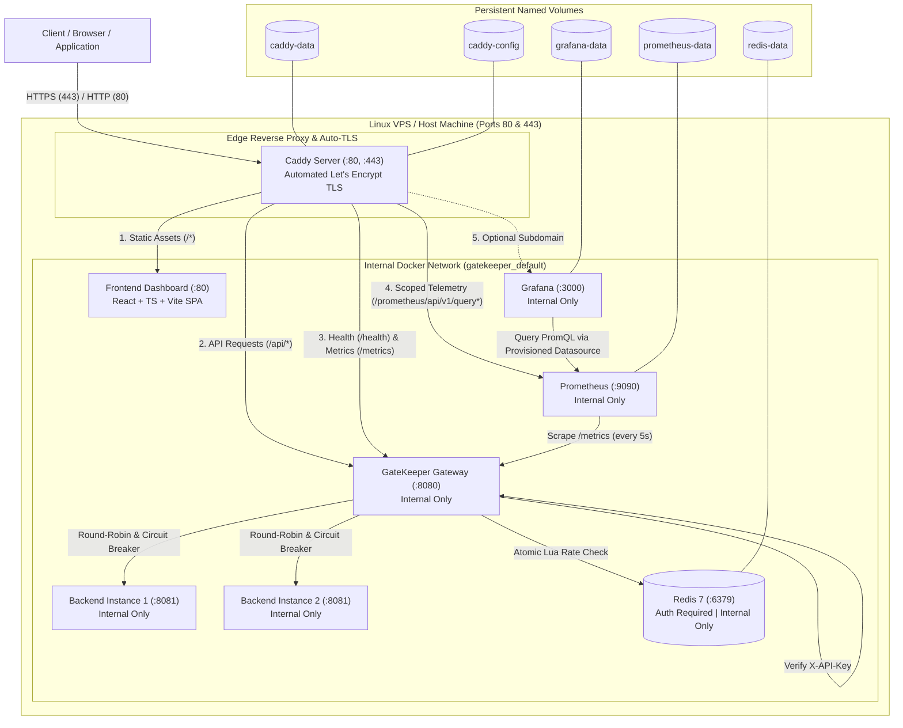

# GateKeeper

GateKeeper is a lightweight, high-performance API Gateway written in Go. It provides API-key authentication, atomic Redis-backed sliding-window rate limiting, round-robin load balancing with independent per-backend circuit breakers, reverse proxying, Prometheus metrics instrumentation, a modern React developer dashboard, and automated TLS termination via Caddy—packaged for turnkey deployment using Docker Compose.

---

## Architecture Overview



---

## Features

- **Automated HTTPS & Edge Routing**: Caddy edge reverse proxy with automatic Let's Encrypt TLS certificate provisioning, HTTP-to-HTTPS redirection, and modern HTTP/2 + HTTP/3 support.
- **API-Key Authentication**: Constant-time verification (`subtle.ConstantTimeCompare`) of the `X-API-Key` header on all `/api/*` routes.
- **Atomic Redis Rate Limiting**: Fixed/sliding-window rate limiting powered by a single-threaded Redis Lua script to prevent concurrency race conditions. Supports password-authenticated Redis connections.
- **Round-Robin Load Balancing**: Thread-safe round-robin routing across multiple upstream backend instances (`backend-1`, `backend-2`).
- **Independent Circuit Breakers**: Dedicated per-backend circuit breakers with isolated failure thresholds, cooldown intervals, and half-open trial probes. Automatically skips failing backends and fast-fails with `503 Service Unavailable` and `Retry-After` if all backends are down.
- **Credential Privacy**: Derives a deterministic SHA-256 hash from incoming API keys. Raw keys are never stored in Redis, printed to logs, or exposed.
- **Fail-Safe Design**: Returns `HTTP 503 Service Unavailable` if Redis is unreachable—never silently bypassing rate limits.
- **Interactive Monitoring Dashboard**: React + TypeScript + Vite single-page application served via a multi-stage Caddy container, featuring real-time telemetry, backend circuit breaker states, and an interactive API playground.
- **Scoped Telemetry Ingress**: Prometheus query access through the edge proxy is strictly restricted to query endpoints (`/prometheus/api/v1/query` and `/query_range`) used by the dashboard. Administrative and destructive Prometheus endpoints are blocked with `403 Forbidden`.
- **Internal Service Isolation**: Upstream backends, Redis, Prometheus, Grafana, and the gateway do not publish ports to the public host interface. All public traffic must enter through Caddy on ports 80 and 443.

---

## Technology Stack

| Layer | Component | Description |
|---|---|---|
| **Edge Proxy** | Caddy 2.8 (`caddy:2.8-alpine`) | Automated TLS, reverse proxy, compression, and static asset serving |
| **API Gateway** | Go 1.26 | Standard library `net/http`, reverse proxy, load balancer, circuit breakers |
| **Dashboard** | React 19 + TypeScript + Vite + Tailwind | Modern real-time gateway developer dashboard |
| **Cache / Token Store** | Redis 7 (`redis:7-alpine`) | In-memory token counter with AOF persistence and password auth |
| **Metrics Collection** | Prometheus (`prom/prometheus:latest`) | Time-series metrics collection and scraping |
| **Visualization** | Grafana (`grafana/grafana:latest`) | Analytics dashboard provisioned with Prometheus data source |
| **Containerization** | Docker & Docker Compose v2 | Multi-container orchestrated deployment with logging limits |

---

## Production Deployment Guide (Single Linux VPS)

This guide walks through deploying GateKeeper to a single Linux Virtual Private Server (Ubuntu 22.04 LTS or Debian 12 recommended).

### 1. Prerequisites

1. **Linux VPS**: A cloud VPS (e.g. Hetzner, DigitalOcean, Linode, AWS EC2) with at least 1 GB RAM and 1 vCPU.
2. **DNS Records**: Configure your domain's DNS `A` (and optional `AAAA`) records to point to your VPS public IP:
   * `gatekeeper.yourdomain.com` $\rightarrow$ `<VPS-PUBLIC-IP>`
   * `grafana.yourdomain.com` (optional) $\rightarrow$ `<VPS-PUBLIC-IP>`
3. **Docker Engine & Compose**:
   ```bash
   # Install Docker using the official convenience script
   curl -fsSL https://get.docker.com | sh
   sudo usermod -aG docker $USER
   # Log out and log back in to apply group changes
   ```

### 2. Firewall Configuration (UFW)

Ensure only SSH (22), HTTP (80), and HTTPS (443) are publicly reachable. Internal services (`8080`, `8081`, `6379`, `9090`, `3000`) must be blocked from WAN:

```bash
# Enable UFW firewall
sudo ufw default deny incoming
sudo ufw default allow outgoing
sudo ufw allow 22/tcp comment 'SSH'
sudo ufw allow 80/tcp comment 'Caddy HTTP'
sudo ufw allow 443/tcp comment 'Caddy HTTPS'
sudo ufw enable
sudo ufw status verbose
```

### 3. Clone Repository & Setup Environment

```bash
# Clone the repository
git clone https://github.com/pragyan43jain/GateKeeper.git
cd GateKeeper

# Copy the production environment template
cp .env.example .env
```

Generate cryptographically secure secrets and fill in `.env`:

```bash
# Generate secrets
API_KEY=$(openssl rand -hex 24)
REDIS_PW=$(openssl rand -hex 24)
GRAFANA_PW=$(openssl rand -hex 24)

# Populate .env
sed -i "s/your-secure-gateway-api-key-here/$API_KEY/" .env
sed -i "s/your-secure-redis-password-here/$REDIS_PW/" .env
sed -i "s/your-secure-grafana-password-here/$GRAFANA_PW/" .env
sed -i "s/DOMAIN_NAME=localhost/DOMAIN_NAME=gatekeeper.yourdomain.com/" .env
sed -i "s/ACME_EMAIL=admin@example.com/ACME_EMAIL=your-email@yourdomain.com/" .env
sed -i "s/GRAFANA_DOMAIN=grafana.localhost/GRAFANA_DOMAIN=grafana.yourdomain.com/" .env
```

Verify your `.env` contains valid values (do not share or commit this file):
```bash
grep -E '^(DOMAIN_NAME|ACME_EMAIL|GATEKEEPER_API_KEY|REDIS_PASSWORD|GRAFANA_ADMIN_PASSWORD)=' .env
```

### 4. Build and Start Services

```bash
# Build multi-stage images and start in detached mode
docker compose up -d --build
```

### 5. Verification & Health Check

1. **Verify Container Health**:
   ```bash
   docker compose ps
   ```
   All 7 containers (`caddy`, `frontend`, `gateway`, `backend-1`, `backend-2`, `redis`, `prometheus`, `grafana`) should show status `Up (healthy)`.

2. **Verify Public Health Endpoint (over HTTPS)**:
   ```bash
   curl -i https://gatekeeper.yourdomain.com/health
   # Expected: HTTP/2 200 OK with body "Gatekeeper is healthy"
   ```

3. **Verify Authenticated API Route & Load Balancing**:
   ```bash
   # Read your API key from .env
   KEY=$(grep GATEKEEPER_API_KEY .env | cut -d '=' -f2)

   # Send requests to observe round-robin alternation across backends
   curl -i -H "X-API-Key: $KEY" https://gatekeeper.yourdomain.com/api/students
   curl -i -H "X-API-Key: $KEY" https://gatekeeper.yourdomain.com/api/students
   # Check response headers: X-Backend-Id should alternate between backend-1 and backend-2
   ```

4. **Verify Unauthorized Requests**:
   ```bash
   curl -i https://gatekeeper.yourdomain.com/api/students
   # Expected: HTTP/2 401 Unauthorized
   ```

5. **Verify Rate Limiting**:
   Send 11 rapid requests with your API key to observe the sliding-window limit:
   ```bash
   for i in {1..11}; do
     curl -s -o /dev/null -w "%{http_code}\n" -H "X-API-Key: $KEY" https://gatekeeper.yourdomain.com/api/students
   done
   # Expected: First 10 return 200, 11th returns 429 Too Many Requests with Retry-After header
   ```

6. **Verify Scoped Prometheus Protection & Method Restrictions**:
   ```bash
   # Permitted GET queries (returns HTTP/2 200 OK)
   curl -i https://gatekeeper.yourdomain.com/prometheus/api/v1/query?query=up
   curl -i "https://gatekeeper.yourdomain.com/prometheus/api/v1/query_range?query=up&start=$(($(date +%s)-60))&end=$(date +%s)&step=15s"

   # Disallowed HTTP method on query route (returns HTTP/2 405 Method Not Allowed)
   curl -i -X POST https://gatekeeper.yourdomain.com/prometheus/api/v1/query
   curl -i -X DELETE https://gatekeeper.yourdomain.com/prometheus/api/v1/query

   # Blocked administrative/diagnostic endpoints (returns HTTP/2 403 Forbidden)
   curl -i https://gatekeeper.yourdomain.com/prometheus/api/v1/admin/tsdb/clean_tombstones
   curl -i -X POST https://gatekeeper.yourdomain.com/prometheus/-/quit
   ```

7. **Verify Browser Security Headers**:
   ```bash
   curl -I https://gatekeeper.yourdomain.com/
   # Expected headers:
   # Strict-Transport-Security: max-age=31536000
   # X-Content-Type-Options: nosniff
   # X-Frame-Options: DENY
   # Referrer-Policy: strict-origin-when-cross-origin
   # Permissions-Policy: camera=(), microphone=(), geolocation=()
   # Content-Security-Policy: default-src 'self'; script-src 'self'; style-src 'self' 'unsafe-inline'; ...
   ```

---

## Security Architecture & Hardening

### 1. Ingress & Browser Security Headers
The public Caddy reverse proxy terminates TLS and injects standardized browser defense-in-depth headers on all external responses:
- `Strict-Transport-Security`: Enforces HTTPS for all client sessions.
- `X-Content-Type-Options: nosniff`: Prevents MIME-type confusion attacks.
- `X-Frame-Options: DENY`: Prevents clickjacking and framing.
- `Referrer-Policy: strict-origin-when-cross-origin`: Minimizes referrer leakage.
- `Permissions-Policy`: Restricts browser sensors (camera, microphone, geolocation).
- `Content-Security-Policy`: Scoped to safely permit React + Vite scripts, dynamic SVG and styling used by Recharts (`'unsafe-inline'`), and outgoing API Playground requests (`connect-src 'self' https: http:`) while blocking rogue script/plugin execution.

### 2. Scoped Telemetry Ingress
- Only HTTP `GET` requests to `/prometheus/api/v1/query` and `/prometheus/api/v1/query_range` are forwarded to Prometheus for dashboard charts.
- Non-GET methods (POST, PUT, DELETE) on query endpoints are rejected at the edge with `HTTP 405 Method Not Allowed`.
- All other paths (`/graph`, `/api/v1/admin/*`, `/-/quit`, `/-/reload`) are rejected with `HTTP 403 Forbidden` (`Access Denied`).

### 3. Grafana Production Requirements
- **Credentials**:
  - `GRAFANA_ADMIN_USER`: Defaults to `admin`.
  - `GRAFANA_ADMIN_PASSWORD`: **Mandatory** in production `.env`. Must be set to a cryptographically random string (e.g. `openssl rand -hex 24`). Default fallbacks have been removed from Compose. If unset, Grafana starts with a blank password and standard logins are refused.
  - Public registration is permanently disabled (`GF_USERS_ALLOW_SIGN_UP=false`).
- **DNS Requirements**:
  - `GRAFANA_DOMAIN` (e.g. `grafana.yourdomain.com`) requires its own dedicated DNS `A` record pointing to the VPS public IP.
  - If the DNS record is missing, Caddy's ACME certificate challenge for the Grafana subdomain will fail.
- **Access Control**:
  - Direct host port 3000 is not exposed to the WAN.
  - If Grafana should not be public at all, operators can omit `GRAFANA_DOMAIN` from public DNS and access Grafana securely via an SSH tunnel:
    ```bash
    ssh -L 3000:localhost:3000 user@vps-ip
    ```

---

## Maintenance, Logs & Rollback

### Viewing Logs
```bash
# Tail all container logs
docker compose logs -f

# Tail Caddy access & TLS logs
docker compose logs -f caddy

# Tail Gateway proxy & circuit breaker logs
docker compose logs -f gateway
```

### Applying Configuration Updates
```bash
# Restart Caddy after Caddyfile edits
docker compose restart caddy

# Rebuild and restart after code changes
git pull origin main
docker compose up -d --build
```

### Rollback Procedure
If a deployment exhibits regressions:
```bash
# 1. Stop the current deployment
docker compose down

# 2. Checkout the known stable commit or tag
git checkout <stable-commit-hash>

# 3. Rebuild and restart
docker compose up -d --build
```

### Stopping Services & Data Preservation
```bash
# Stop containers (preserves all volume data)
docker compose down

# Warning: The following command destroys rate limit history and Prometheus metrics:
# docker compose down -v
```

---

## Local Development Workflows

### Workflow A: Local Ingress Development (Recommended)
You can run the full containerized stack locally without touching raw host ports:
```bash
# 1. Start the stack (Caddy listens on localhost:80 and localhost:443)
docker compose up -d --build

# 2. Start the Vite dev server for hot-reload frontend development
cd frontend
npm install
npm run dev
# The Vite dev proxy automatically routes /api, /health, /metrics, and /prometheus
# to https://localhost (Caddy) without needing raw gateway/prometheus ports.
```

### Workflow B: Direct Loopback Debugging (`docker-compose.dev.yml`)
If you require direct access to internal container ports for debugging, use the development override which binds ports strictly to `127.0.0.1` (never `0.0.0.0`):
```bash
# Start with the development override
docker compose -f docker-compose.yml -f docker-compose.dev.yml up -d

# Direct loopback endpoints available:
# - Gateway:    http://127.0.0.1:8082
# - Prometheus: http://127.0.0.1:9090
# - Grafana:    http://127.0.0.1:3000

# Run frontend against raw gateway port:
cd frontend
VITE_PROXY_TARGET=http://localhost:8082 npm run dev
```

### Running Backend Tests
```bash
go test -v -count=1 ./...
go test -race -v -count=1 ./...
go vet ./...
```

