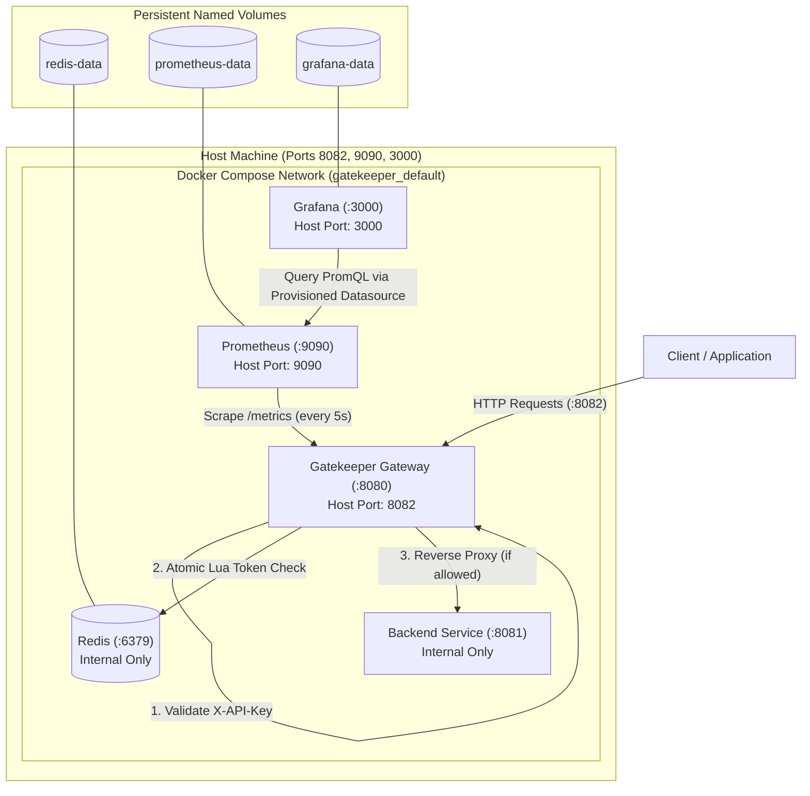

# GateKeeper

GateKeeper is a lightweight, high-performance API Gateway written in Go. It provides API-key authentication, atomic Redis-backed rate limiting, reverse proxying, Prometheus metrics instrumentation, and pre-configured Grafana monitoring—packaged for turnkey deployment using Docker Compose.

---

## Architecture Overview



---

## Features

- **API-Key Authentication**: Constant-time verification (`subtle.ConstantTimeCompare`) of the `X-API-Key` header on all `/api/*` routes.
- **Atomic Redis Rate Limiting**: Fixed-window rate limiting (10 requests per 60s window by default) powered by a single-threaded Redis Lua script to prevent concurrency race conditions.
- **Credential Privacy**: Derives a deterministic SHA-256 hash from incoming API keys. Raw keys are never stored in Redis or written to logs.
- **Fail-Safe Design**: Returns `HTTP 503 Service Unavailable` if Redis is unreachable—never silently bypassing rate limits.
- **Standard HTTP Rate Limit Headers**: Emits `X-RateLimit-Limit`, `X-RateLimit-Remaining`, and standard `Retry-After` headers on `HTTP 429 Too Many Requests`.
- **Prometheus Metrics**: Exposes `gateway_requests_total`, `gateway_request_duration_seconds` (histogram), and `gateway_rate_limit_rejections_total` on `/metrics`.
- **Automated Grafana Provisioning**: Automatically registers Prometheus as the default data source on startup.
- **Container Hardening**: Multi-stage Docker builds based on `golang:alpine` and `alpine:latest` running under non-root users (`appuser`).
- **Internal Service Isolation**: Backend and Redis containers are strictly private to the Compose network; only Gateway, Prometheus, and Grafana expose host ports.

---

## Technology Stack

| Layer | Component | Description |
|---|---|---|
| **Language** | Go 1.26 | Standard library `net/http` and `net/http/httputil` |
| **Data Store / Cache** | Redis 7 (`redis:7-alpine`) | In-memory token counter with AOF persistence |
| **Redis Client** | `github.com/redis/go-redis/v9` | Go Redis client with Lua script execution |
| **Metrics** | `github.com/prometheus/client_golang` | Prometheus Go metrics collector & exposition |
| **Monitoring** | Prometheus (`prom/prometheus:latest`) | Time-series metrics collection & scraping |
| **Visualization** | Grafana (`grafana/grafana:latest`) | Analytics dashboards & metric exploration |
| **Containerization** | Docker & Docker Compose v2 | Multi-container orchestrated deployment |

---

## Prerequisites

- **Docker Engine** (20.10+) and **Docker Compose** (v2.0+)
- *(Optional for local Go development)*: **Go 1.26+** and a running local **Redis** instance (`redis-cli ping` returns `PONG`).

---

## Environment Variables

Copy the provided example environment template:

```bash
cp .env.example .env
```

### Configuration Keys

| Variable | Default Value | Description |
|---|---|---|
| `GATEKEEPER_API_KEY` | *(Required, e.g. `dev-secret-change-me`)* | Master secret API key required by incoming `/api/*` requests. |
| `REDIS_ADDR` | `redis:6379` (Docker) / `localhost:6379` (Local) | Redis hostname and port. |
| `REDIS_PASSWORD` | `""` | Optional password for Redis authentication. |
| `REDIS_DB` | `0` | Redis logical database index. |
| `REDIS_KEY_PREFIX` | `gatekeeper:rate_limit:` | Prefix applied to Redis rate-limit counter keys. |
| `BACKEND_URL` | `http://backend:8081` (Docker) / `http://localhost:8081` (Local) | Upstream destination URL for reverse proxying. |
| `PORT` | `8080` | Port the Gateway HTTP server listens on inside its container/environment. |
| `RATE_LIMIT_MAX_REQUESTS` | `10` | Maximum requests permitted per window per API key. |
| `RATE_LIMIT_WINDOW` | `60s` | Time window duration for rate limits (Go duration format). |

> [!NOTE]
> `.env` is listed in `.gitignore` and `.dockerignore` to ensure local secrets are never committed to version control or baked into image layers.

---

## Running with Docker Compose

### 1. Build and Start All Services

```bash
# Start all 5 services in detached mode
docker compose up -d --build
```

### 2. Verify Service Health

```bash
docker compose ps
```

Expected healthy output:
```text
NAME                      IMAGE                STATUS                    PORTS
gatekeeper-backend-1      gatekeeper-backend   Up (healthy)              8081/tcp
gatekeeper-gateway-1      gatekeeper-gateway   Up (healthy)              0.0.0.0:8082->8080/tcp
gatekeeper-redis-1        redis:7-alpine       Up (healthy)              6379/tcp
gatekeeper-prometheus-1   prom/prometheus      Up (healthy)              0.0.0.0:9090->9090/tcp
gatekeeper-grafana-1      grafana/grafana      Up (healthy)              0.0.0.0:3000->3000/tcp
```

### 3. View Logs

```bash
# Follow logs across all containers
docker compose logs -f

# Follow gateway logs only
docker compose logs -f gateway
```

### 4. Stop Services

```bash
# Stop containers (preserves volume data)
docker compose down

# Stop containers and remove persistent volumes
docker compose down -v
```

---

## API Usage & Endpoints

### 1. Public Health Check
The `/health` endpoint is unauthenticated and independent of Redis:

```bash
curl -i http://localhost:8082/health
```

**Response**:
```http
HTTP/1.1 200 OK
Content-Type: text/plain

Gatekeeper is healthy
```

---

### 2. Authenticated API Request (Forwarded to Backend)
Include the configured API key in the `X-API-Key` header:

```bash
curl -i -H "X-API-Key: dev-secret-change-me" http://localhost:8082/api/students
```

**Response**:
```http
HTTP/1.1 200 OK
Content-Type: application/json
X-Gateway: Gatekeeper
X-Ratelimit-Limit: 10
X-Ratelimit-Remaining: 9

{"message":"Hello from backend","students":["Arjun","Priya","Rahul"]}
```

---

### 3. Unauthorized Requests (Missing or Invalid Key)

```bash
# Missing header
curl -i http://localhost:8082/api/students

# Invalid key
curl -i -H "X-API-Key: wrong-key" http://localhost:8082/api/students
```

**Response**:
```http
HTTP/1.1 401 Unauthorized
Content-Type: text/plain; charset=utf-8

Unauthorized
```

---

### 4. Rate Limiting in Action (Exceeding Quota)
Send 11 rapid requests with a valid key:

```bash
for i in {1..11}; do
  curl -s -o /dev/null -w "Request $i: HTTP %{http_code}\n" -H "X-API-Key: dev-secret-change-me" http://localhost:8082/api/students
done
```

**Expected 11th Request Response**:
```http
HTTP/1.1 429 Too Many Requests
Content-Type: text/plain; charset=utf-8
Retry-After: 58

Too Many Requests: rate limit exceeded. Retry after 58 seconds
```

---

## Monitoring & Dashboards

### Web Interfaces

| Service | URL | Credentials | Purpose |
|---|---|---|---|
| **Gatekeeper API** | [http://localhost:8082](http://localhost:8082) | `X-API-Key: dev-secret-change-me` | Reverse proxy & API traffic |
| **Prometheus Metrics** | [http://localhost:8082/metrics](http://localhost:8082/metrics) | *None (Public)* | Raw Prometheus text exposition |
| **Prometheus Web UI** | [http://localhost:9090](http://localhost:9090) | *None* | Metric exploration, PromQL queries, targets status |
| **Grafana UI** | [http://localhost:3000](http://localhost:3000) | `admin` / `admin` | Dashboards (Prometheus pre-configured) |

---

### Tracked Metrics

| Metric Name | Type | Labels | Description |
|---|---|---|---|
| `gateway_requests_total` | Counter | `code`, `method` | Total application HTTP requests processed by Gatekeeper. |
| `gateway_request_duration_seconds` | Histogram | `code`, `method` | Latency distribution of requests in seconds across standard buckets. |
| `gateway_rate_limit_rejections_total` | Counter | *None* | Total requests rejected with HTTP 429. |

> [!NOTE]
> Scrapes against `/metrics` are deliberately excluded from `gateway_requests_total` and latency tracking to prevent metrics scraper distortion.

---

### Example PromQL Queries

Paste these queries into the **Prometheus Graph UI** (`http://localhost:9090/graph`) or **Grafana Explore** (`http://localhost:3000/explore`):

- **Request Rate by HTTP Status Code (req/sec)**:
  ```promql
  sum by (code) (rate(gateway_requests_total[1m]))
  ```

- **Rate-Limited Rejection Rate (req/sec)**:
  ```promql
  rate(gateway_rate_limit_rejections_total[1m])
  ```

- **95th Percentile Latency (p95)**:
  ```promql
  histogram_quantile(0.95, sum by (le) (rate(gateway_request_duration_seconds_bucket[5m])))
  ```

- **Average Request Latency (seconds)**:
  ```promql
  rate(gateway_request_duration_seconds_sum[1m]) / rate(gateway_request_duration_seconds_count[1m])
  ```

- **Target Scrape Health**:
  ```promql
  up{job="gatekeeper"}
  ```

---

## Running Go Tests Locally

Ensure local Redis is running on `localhost:6379` before running tests (the test suite uses an isolated `gatekeeper:test:*` keyspace and automatically cleans up keys upon completion).

```bash
# Run unit and integration tests
go test -v ./...

# Run tests with the Go race detector
go test -race -v ./...

# Run code formatting check
gofmt -s -w .
```

---

## Security & Privacy Considerations

1. **SHA-256 API Key Hashing**:
   Gatekeeper hashes incoming API keys with `crypto/sha256` before interacting with Redis or emitting log lines. The raw API key is never written to Redis keys, TTL records, or server logs.
2. **Fail-Safe 503 Policy**:
   If Redis becomes unreachable or connection timeouts occur, Gatekeeper logs an error and returns `HTTP 503 Service Unavailable`. It refuses to fail open, preventing uncontrolled traffic spikes against upstream backends during cache outages.
3. **Private Backend & Cache**:
   In `docker-compose.yml`, neither `backend` (8081) nor `redis` (6379) expose ports to the host machine. They communicate exclusively over the internal Docker bridge network.
4. **Non-Root Container Execution**:
   Dockerfiles declare an explicit unprivileged user (`USER appuser`) so gateway and backend processes run without root privileges inside containers.

---

## Troubleshooting

### 1. Port Already in Use (e.g. 8082, 9090, 3000)
If Docker fails to bind a host port:
```bash
# Identify process holding the port
lsof -i :8082 -i :9090 -i :3000

# Stop any conflicting background processes or modify the host port in docker-compose.yml
```

### 2. Backend Health Check Failures
The backend health check requires fetching `/api/students` using `wget -q --tries=1 -O /dev/null http://127.0.0.1:8081/api/students`. Avoid using `wget --spider` because the backend restricts non-GET methods and BusyBox `--spider` sends `HEAD` requests, causing an `HTTP 405 Method Not Allowed` exit code 8 failure.

### 3. Prometheus Target Shows DOWN
- Verify the Gateway container is healthy: `docker compose ps gateway`.
- Check that Gateway metrics are accessible internally:
  ```bash
  docker compose exec prometheus wget -q -O - http://gateway:8080/metrics
  ```
- Ensure `prometheus/prometheus.yml` lists target `gateway:8080`.

### 4. Redis Connection Error (503 Service Unavailable)
- Check Redis container status: `docker compose ps redis`.
- Inspect logs for connection refused: `docker compose logs redis`.
- Ensure `REDIS_ADDR` is set to `redis:6379` when running inside Docker Compose.

